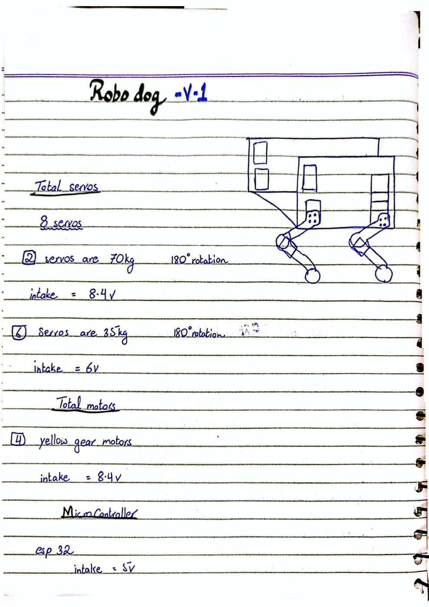
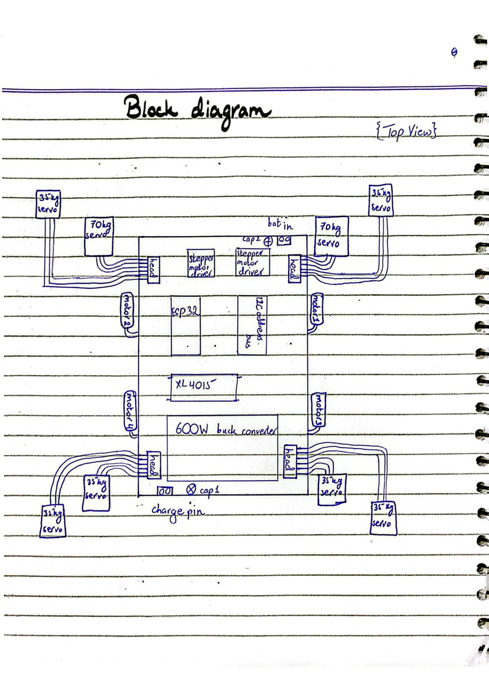
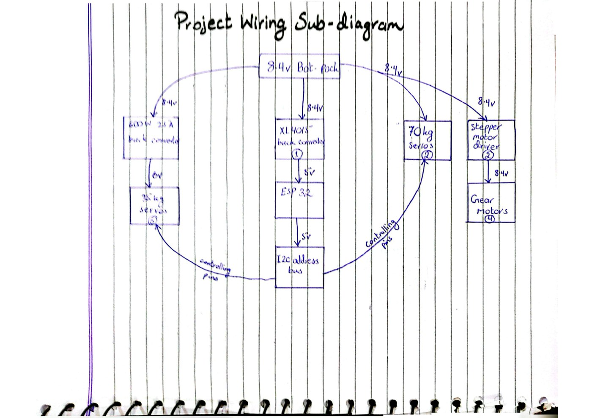
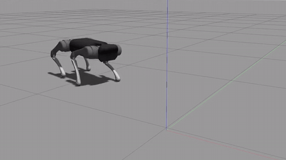

# Robodog

A wheel-legged quadruped built by the intern team at the **National Centre of Robotics and Automation (NCRA), NUST**, in July–August 2026. Each of the four legs has two servos and a geared wheel at the foot. I worked on the simulation, the schematics, the veroboard prototype and the PCB, and the robot walked end to end.

This repository holds:

- my design notebook pages: the block diagram, the power wiring and the specs (`docs/`)
- the gait firmware that ran on the robot (`firmware/robodog_trot/`)
- the gait simulation from Gazebo (`media/`)

## Design notebook

<table>
<tr>
<td width="50%"></td>
<td width="50%"></td>
</tr>
<tr>
<td align="center">Specs: servos, motors and the microcontroller</td>
<td align="center">Block diagram of the board, top view</td>
</tr>
</table>

The full scan is in [`docs/robodog-design-notebook.pdf`](docs/robodog-design-notebook.pdf).

## Hardware

| Part | Count | Power |
|---|---|---|
| 70 kg-cm servos, 180° | 2 | 8.4 V straight from the battery |
| 35 kg-cm servos, 180° | 6 | 6 V from a 600 W DC-DC converter (up to 25 A) |
| Geared wheel motors | 4 | 8.4 V through two TB6612FNG dual motor drivers, two motors each |
| ESP32 | 1 | 5 V from an XL4015 buck converter |
| 16-channel I2C servo driver (PCA9685) | 1 | addresses all 8 servos |
| Li-ion battery pack | 1 | 8.4 V |

## Power design

The 8.4 V pack feeds three separate paths, so the servos' current spikes never reach the logic supply:

1. **XL4015 buck converter → 5 V** for the ESP32 and the I2C servo driver.
2. **600 W DC-DC converter → 6 V, up to 25 A** for the six 35 kg-cm servos.
3. **Battery direct, 8.4 V** for the two 70 kg-cm servos and the two TB6612FNG motor drivers.

## Gait firmware

[`firmware/robodog_trot/robodog_trot.ino`](firmware/robodog_trot/robodog_trot.ino) is the Arduino sketch that ran on the ESP32.

- Drives all 8 leg servos through the PCA9685 at 60 Hz: one femur and one tibia servo per leg, on channels 0–7.
- Starts from a calibrated stand pose, with per-leg direction and gain tables so every leg swings by the same amount.
- Walks with a diagonal trot: front-left with rear-right, then front-right with rear-left. Each half-step has four phases (lift and swing, carry, plant and push, settle) of 200 ms, so a full stride takes 1.6 s.
- `testLeg()` moves one leg at a time, for tuning with the robot propped up off the ground.

To build it: Arduino IDE with the ESP32 board package and the Adafruit PWM Servo Driver library.

## Simulation

Gait and jump testing in Gazebo with the open-source Unitree A1 quadruped model. The full-quality clip is [`media/gait-simulation.mp4`](media/gait-simulation.mp4).

## Team

Built with the NCRA intern team at NUST.

## License

MIT, see [`LICENSE`](LICENSE).
